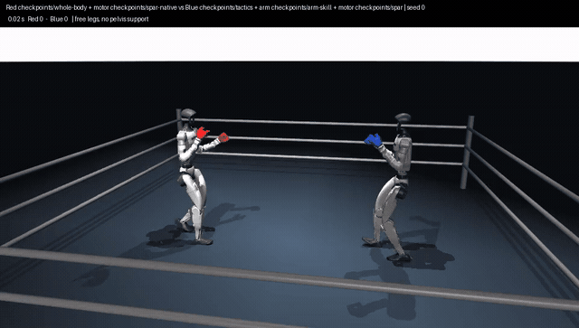
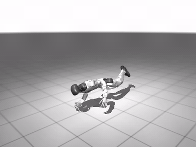

# boxer — two humanoids learning to fight each other in JAX



**Whole body (red) vs Champion (blue).** The strongest boxer, one network for
all 23 leg, waist and arm joint targets, in a 12-second native MuJoCo bout
against the champion stack: free legs, no pelvis support, fists in each
corner's color. Red lands 29 clean punches to 1.
[Preview video](fights/whole_body_vs_champion_preview.mp4); 60-second bouts
[vs the champion](fights/whole_body_vs_champion_60s.mp4) (218 : 60),
[vs the striker](fights/whole_body_vs_striker_60s.mp4) (194 : 16) and
[vs itself](fights/whole_body_vs_itself_60s.mp4); a
[knockdown, count and get-up](fights/whole_body_getup_vs_champion.mp4) in a bout.



**Getting up.** `checkpoints/getup` stands a G1 up from lying on the floor in
about a second, unassisted ([video](fights/getup_from_the_floor.mp4), [get-up](docs/getup.md)).

## Where things stand (2026-11-13)

Two simulated Unitree G1 humanoids box each other in native MuJoCo with no
physical assistance: free legs and roots, no pelvis springs, welds or
gravity compensation. Every policy is learned except the scripted punch
paths of the champion stack and a scripted sparring brain. A punch scores
only as a physical impact of a fist on the opponent's head or torso (native
impact scorecard: impulse, closing speed and fist speed). Bouts of 120 s run
inside a 4 m roped ring under knockdown rules: a fall is counted, both robots
are reset standing, and a third knockdown is a TKO. A learned get-up policy
can replace the reset with a referee's count (`--getup`, below).

Three complete boxers exist. The strongest is one policy for the whole body;
the other two are stacks of separately trained parts:

| Boxer | Legs | Brain and arms | Style |
| --- | --- | --- | --- |
| **Whole body** (strongest) | — | `checkpoints/whole-body`: one network sets all 23 leg, waist and arm joint targets every step; no motor, no scripted moves | in-fighting, very high punch rate |
| **Striker** | `checkpoints/spar-native` | `checkpoints/striker`: one policy for footwork and both arms' joint targets, no scripted moves | in-fighting, short hook-like punches |
| **Champion** (reference) | `checkpoints/spar` | `checkpoints/tactics` (footwork, punch choice, guard height) + scripted straights and hooks (`boxer/moves.py`) bent by `checkpoints/arm-skill` | longer straights, high guard |

Over 32 bouts of 120 s (16 seeds, corners swapped), each opponent on its own
legs:

| Bouts | Record | Clean punches per bout | Knockdowns |
| --- | --- | --- | --- |
| whole body vs champion | 32–0 | 427 : 143 | 2 : 0 |
| whole body vs striker | 32–0 | 374 : 43 | 1 : 0 |
| whole body vs the previous whole body (`whole-body-v2`) | 32–0 | 348 : 199 | 7 : 17 |
| striker vs champion | 32–0 | 256 : 87 | 1 : 4 |
| whole body vs itself / striker vs itself | — | — | 16 / 20 in all |

([whole body](docs/whole-body.md#starts-from-the-end-of-a-referees-count-run-6-promoted),
[striker](docs/striker.md#legs-trained-in-two-robot-bouts-2026-11-03);
60 s videos at 60 fps: [whole body](fights/whole_body_vs_champion_60s.mp4),
[striker](fights/striker_native_legs_vs_champion_60s.mp4)).

```bash
bash tools/run_spar.sh boxer.spar_match --ring --seconds 120 --knockdowns 3 --seeds 0 1 2 3 --swap \
  --checkpoint checkpoints/spar-native --red-tactics checkpoints/whole-body \
  --blue-checkpoint checkpoints/spar --blue-tactics checkpoints/tactics --blue-arm checkpoints/arm-skill \
  --video runs/fight.mp4
```

**Limits, measured:**

* **Falls in close brawls.** Two strikers fighting chest to chest fall
  about 20 times in 32 bouts of 120 s. Neither more leg training nor
  alternating leg and striker rounds reduced it
  ([spar motor](docs/spar-motor.md#legs-trained-in-two-robot-bouts-2026-11-03),
  [rounds](docs/striker.md#long-bout-gate-and-alternating-rounds-2026-11-11)).
  Two whole-body policies fall 0 times. A leg anchor for the motor did not
  help either ([spar motor](docs/spar-motor.md#legs-trained-in-two-robot-bouts-2026-11-03)).
* **The strongest boxer still falls against the champion.** The whole body
  falls 8 times in 32 bouts against the champion stack (the previous one: 1),
  though it wins all 32.
* **No clinches, but close.** The striker and the whole-body policy fight at
  about 0.55 m between pelvises, which is punching range. Bodies touch on at most
  2 % of steps, for at most 0.1 s at a time. `spar_match --clinch-break` would
  separate a clinch, but it never fires
  ([clinches](docs/striker.md#clinches-measured-and-a-referee-break-2026-11-12)).
* **Getting up works; the count stays optional.** `checkpoints/getup`
  stands a fallen G1 up in about 1 s, in the GPU stage and in native MuJoCo.
  With a referee's count in place of the reset, the stacks and strikers often
  fall again just after resuming. The whole body, trained from states where a
  count ends, was not knocked down once in 32 counted bouts against the
  champion, but evaluations keep the reset
  ([get-up](docs/getup.md#neutral-spots-after-the-count-2026-11-13)).
* **The whole body falls in mirror bouts.** Run 6 suffers 8 knockdowns each
  in 32 bouts against itself, where run 5 had none. Self-play (run 7) and a
  smaller share of post-count starts (run 8) did not fix it without losing
  elsewhere; run 6's recipe with another seed and a mirror check in the gate
  (run 9) fell 16–21 times against the champion, and 60 s training
  episodes (run 10) 5–14 times ([whole body](docs/whole-body.md#falls-against-itself-runs-7-to-10-rejected)).
* **Stacks are trained part by part.** In the two stacks, legs, tactics, arm
  skill and striker are separate policies trained in turn; changing one (e.g.
  a striker's arm style) can break another (its legs), as several experiments
  below show. The [whole-body policy](docs/whole-body.md) has no parts.
* **Short training episodes hide falls.** PPO used 20 s episodes, and falls
  show up over 120 s. The native gate now checks 120 s bouts before it
  promotes anything (`--long-gate`); it rejected 4 of the 5 runs before the
  whole-body policy. For the whole-body policy, ablations show the falls are
  held off by anchoring its legs to the striker's gait and by a ~2 s return
  horizon, not by the episode length
  ([ablations](docs/whole-body.md#ablations-the-leg-anchor-and-the-horizon-carry-it)).
  20 s episodes are the default for native fine-tuning
  (`native_finetune --episode-seconds 20`); the 120 s gate catches the falls.
* **Turning is automatic in the stacks.** Their brains choose advance and
  circling; facing the opponent is a fixed rule (`tactics_env.decode`). The
  whole-body policy has no such rule: its own leg targets turn it.
* **Simulation only**, against a fixed pool of policies; no sim-to-real work.
* **Tests:** all 86 test files (443 tests) pass when run one file per
  process (`tools/test_all.sh`, 33 min, 2026-11-12); the whole suite in one
  process exhausts the WSL VM's memory. `--fast` skips the five slow files of
  the archived MJX/warp stack (`tools/slow_tests.txt`) and takes about 13 min.

**Checkpoints.** Current: `whole-body`, `spar`, `spar-native`, `tactics`,
`arm-skill`, `striker`, `getup` (gets a fallen G1 up). Also kept:
`whole-body-v2` (the previous whole-body policy, run 5), `whole-body-v1` (run 3), `whole-body-clone`
(the whole-body policy's starting point, imitating the striker). Earlier, kept for comparison: `striker-v1` (first striker),
`spar-v2` (rapid-punching legs), `spar-v1`, `spar-shorthook`,
`spar-straight` (earlier spar motors), `tactics-arm-v1`, `tactics-ring-v1`,
`tactics-highguard-v1`, `tactics-levelhook-v1`, `tactics-guard-v1`,
`tactics-native-v1`, `tactics-batched` (earlier tactics champions; play each
on the legs it was trained on, see [tactics](docs/tactics.md)),
`curriculum` (certified balance/walk/approach foundation), `skills_seed_2m`
and `skills_200m` (archived assisted boxing), `striking-pilot` and
`striking-validation` (archived paired striking pilot).

## Progress timeline

Newest last. Every row links to the report with protocols and full results;
[experiment history](docs/experiment-history.md) has one row per experiment
since 2026-10-30, including the rejected ones.

| Dates | Phase | What was tried and measured | Outcome |
| --- | --- | --- | --- |
| 10-06 – 10-08 | MJX boxing environment | Two G1s in one MJX scene, Brax PPO; symmetric self-play, frozen opponent and league compared ([results](docs/archive/mjx-warp-experiments.md#results)). Arena numbers before 10-08 used the wrong action scale; corrected and two conclusions withdrawn. | Robots mostly fall; best policy wins 64 % against a passive opponent by staying up. |
| 10-09 – 10-16 | Scoring and form | A punch counted as one event with reload and forward travel; closed-fist visuals; guard refit. | Reward changes did not stop the falls ([results](docs/archive/mjx-warp-experiments.md#reweighting-the-reward-changed-nothing)). |
| 10-17 – 10-21 | `mujoco_warp` arms warp1–warp7 | Per-contact force scorecard, termination-bootstrap fix, costed punches; first win rates in `warp_arena`. | Rounds of 364–382 of 480 steps; warp6 beats warp7 0.538–0.395; no head shots. |
| 10-21 | Assisted boxing (archived) | Hierarchical skills policy with pelvis springs holding the robots up. | 3.4 clean punches per round; not unassisted ([notes](docs/assisted-boxing.md)). |
| 10-21 – 10-22 | Unassisted foundation | Curriculum balance → walk_easy → walk → approach, each passing its physical gate twice. | Certified, 475M transitions ([curriculum](docs/curriculum.md)). |
| 10-22 – 10-29 | Paired striking pilot (archived) | Arm residuals over the frozen approach motor, PPO v12–v17, imitation, many audits, a batched CUDA backend. | Isolated real strikes, no reliable reciprocal boxing; robots fell when arms punched ([pilot](docs/striking-pilot.md), [history](docs/experiment-history.md#decisions-and-evidence)). |
| 10-30 | Spar motor | Diagnosis: the leg motor survived 6 % of solo trials while its arms punched. Legs retrained under generated punches and shoves. | 100 % solo survival; first unassisted two-robot bouts: 8/8 go 20 s, 18.6 clean punches ([spar motor](docs/spar-motor.md)). |
| 10-30 – 10-31 | Learned tactics | Batched self-play PPO, then fine-tuning on native MuJoCo workers. | Batched self-play degrades natively; native fine-tuning wins 42–2–4 ([tactics](docs/tactics.md)). |
| 10-31 | Moves, ring, rules | Hooks and high guard, level IK hook, scoring audit, held-high-guard training, long rounds, knockdown rules, roped ring, faster native stepping. | Each new champion beats the last (27–17–4, 37–9–2, 27–16–5 over 48 bouts) ([moves](docs/moves.md), [tactics](docs/tactics.md)). |
| 10-31 | Arm skill | Learned per-step correction (≤ 0.35 rad) of each scripted punch; tactics retrained with it. | 39–4–5 with identical tactics; landing 41 → 50 % ([arm skill](docs/arm-skill.md)). |
| 11-01 | Knockdowns | Census: falls follow shin contact. Motor with phantom shins; leg-contact penalty for tactics. | Both rejected: knockdowns did not drop ([spar motor](docs/spar-motor.md#phantom-shins-and-real-falls-2026-11-01)). |
| 11-02 | Rapid-punching legs | Motor trained with near back-to-back punches; tactics retrained on it. Arm skill retrained on it (rejected: more falls). | New stack 22–9–1, knockdowns 2 to 13 ([spar motor](docs/spar-motor.md#legs-for-rapid-punching-2026-11-02)). |
| 11-03 | Striker | One policy for footwork and both arms: cloned from the champion, then native PPO. | 16–0 in 120 s bouts, 64 % hook-like and 21 % new punch shapes, but 14 knockdowns to 1 ([striker](docs/striker.md)). |
| 11-03 | Legs for the striker's arms | Motor replays recorded striker arm actions in half its episodes. | Striker knockdowns 14 → 1; promoted as `spar` ([details](docs/spar-motor.md#legs-for-the-strikers-arms-2026-11-03)). |
| 11-03 | Arm-motion cost | Striker pays per radian of arm motion; legs retrained solo on its recording. | Per clean punch it already moved as much as the champion; with the cost it fell 29, then 18 times; rejected ([striker](docs/striker.md#arm-motion-cost-2026-11-03)). |
| 11-03 | Legs trained in two-robot bouts | Native PPO for the motor in two-robot ring bouts (`boxer.motor_native`), opponents from strikers, champion and scripted brain. | Low-motion striker knockdowns 29 → 2; promoted (`spar-native`, `striker`). Champion loses 4–28 on these legs, keeps its own. Striker-heavy continuation: no gain ([details](docs/spar-motor.md#legs-trained-in-two-robot-bouts-2026-11-03)). |
| 11-11 | Long-bout gate | Native gate adds 8 bouts of 120 s with knockdown rules against its champion and named opponents before promoting. | Catches unstable candidates (17 : 1 control); adopted ([details](docs/striker.md#long-bout-gate-and-alternating-rounds-2026-11-11)). |
| 11-11 | Alternating legs and striker | Three rounds of native leg training then striker training on the new legs (`boxer.co_train`). | Gate kept 1 of 3 strikers; brawl falls 20 → 28; not promoted ([details](docs/striker.md#long-bout-gate-and-alternating-rounds-2026-11-11)). |
| 11-11 | Whole-body policy | One network for legs, waist and arms (174 → 23), no motor: cloned from the striker, then native PPO. | Clone beats the champion 32–0 (kd 6 : 2); two PPO runs hit more but fell more and were rejected ([whole body](docs/whole-body.md)). |
| 11-11 | Whole body, long episodes | Native PPO on 120 s episodes, γ 0.99, per-step tilt cost, leg outputs anchored to the clone. | First gate-approved whole-body run: vs champion 32–0, 361 : 81, kd 1 : 0; vs striker 31–1; own brawls 4 kd (strikers: 20). **Promoted** (`whole-body`) ([details](docs/whole-body.md#long-episodes-tilt-cost-and-leg-anchor)). |
| 11-12 | Whole-body ablations | Run 3 retrained without each change in turn (1M steps). | Own-brawl knockdowns: no leg anchor 108, γ 0.97 38, no tilt cost 10, 20 s episodes 4 (full: 4, other seed 2) ([ablations](docs/whole-body.md#ablations-the-leg-anchor-and-the-horizon-carry-it)). |
| 11-12 | Whole body vs itself | 2M more steps from `whole-body`, itself in the opponent pool. | Beats the promoted policy 16–0 over 120 s but falls 3–9 times in 16 bouts against the champion; rejected by the long gate ([details](docs/whole-body.md#continued-training-with-itself-in-the-pool-rejected)). |
| 11-12 | Getting up | GPU `getup` stage: whole-body floor contacts, lying and falling starts, height and upright reward; 150M steps from the spar motor, then 200M from scratch with a head-height term. | 0 of 98 fallen starts stood up in either; the second learned to sit ([get-up](docs/getup.md)). |
| 11-12 | Getting up with a fading assist | Upward torso force (× body weight) lowered 0.7 → 0.45, then 0.38 → 0 in 0.06 steps, 290M steps in all. | Unassisted: 99 % of lying and 100 % of falling starts up, in about 1 s; 24 of 24 in native MuJoCo. `checkpoints/getup` ([get-up](docs/getup.md#attempts-3-and-4-an-assist-that-fades-to-zero-worked)). |
| 11-12 | Referee's count | `spar_match --getup`: the fallen boxer gets up while the other waits; mandatory 8 s count, 10 s for a knockout. | 38 of 49 counts end standing, but boxers fall again soon after resuming: whole body vs champion 26–6 (kd 15 : 2) against 32–0 with restarts. Optional; restarts stay the default ([details](docs/getup.md#in-bouts-the-referees-count)). |
| 11-12 | Whole body, self-play with a stack fall penalty | Run 4's pool, plus a 150 fall penalty against stacks and strikers (60 against itself), 20 s episodes. | 0.5M passes every long check; beats run 3 16–0; vs champion 32–0, 419 : 96 but kd 8 : 3. **Promoted** (`whole-body`; run 3 kept as `whole-body-v1`) ([details](docs/whole-body.md#self-play-with-a-heavier-fall-penalty-against-stacks-run-5-promoted)). |
| 11-12 | Leg anchor for the motor | `motor_native --leg-anchor 20` from `spar-native`, striker-heavy pool. | Striker brawls 22 knockdowns (20 before); not promoted ([details](docs/spar-motor.md#legs-trained-in-two-robot-bouts-2026-11-03)). |
| 11-12 | Clinches | Body-contact probe; `spar_match --clinch-break` referee rule. | Bodies touch on ≤ 2 % of steps, ≤ 0.1 s at a time; no clinches to break ([details](docs/striker.md#clinches-measured-and-a-referee-break-2026-11-12)). |
| 11-13 | Neutral spots after the count | `--count-separate 2`: after the count both boxers are moved 2 m apart, facing, joints kept. | Knockdowns down a third (15 → 10, brawl 43 → 24); whole body vs champion 29–3, brawl 31–1; KOs vs champion unchanged (3) ([details](docs/getup.md#neutral-spots-after-the-count-2026-11-13)). |
| 11-13 | Whole body from starts where a count ends | `boxer.getup_starts` bank of 400 native post-count states; run 5's settings with 25 % of bouts from the bank; control without the bank. | 0.25M: beats run 5 32–0; vs champion kd 2 : 0 (run 5 8 : 3, control 18 : 1); counted bouts 0 knockdowns; vs itself 8 : 8. **Promoted** (`whole-body`; run 5 kept as `whole-body-v2`) ([details](docs/whole-body.md#starts-from-the-end-of-a-referees-count-run-6-promoted)). |
| 11-13 | Whole body: falls against itself | Run 7: run 6 and run 5 in the pool, fall penalty 150 for all. Run 8: 10 % of bouts from the bank instead of 25 %. | Run 7 rejected (14–19 kd vs run 6 in the gate); run 8 halves mirror falls (16 → 8) but falls 5 vs champion and loses to run 6 0–32. Run 6 stays ([details](docs/whole-body.md#falls-against-itself-runs-7-to-10-rejected)). |
| 11-14 | Whole body: mirror check in the gate | Run 9: run 6's recipe, seed 309, `--mirror-gate 2` (≤ 2 kd in 16 long bouts against itself). | Rejected: all 4 long-gate candidates fell 16–21 times vs the champion (run 6: 2), so run 6's result is partly its seed. Run 6 stays. |
| 11-14 | Whole body: 60 s training episodes | Run 10: from run 6, its recipe with `--episode-seconds 60` and `--mirror-gate 4`. | Rejected: at best level with run 6 in the short gate; 5–14 kd vs the champion in long bouts. Run 6 stays. |

## Milestones since unassisted two-robot bouts (2026-10-30 onward)

The paragraphs below were written as each result came in; checkpoint names
are given as they are now.

**Unassisted two-robot bouts (2026-10-30).** The paired falls had one cause.
The frozen leg controller had been trained with its arms locked in guard.
While its arms punched, it survived only about 6 % of solo 10 s trials. The
new [`spar` stage](docs/spar-motor.md) trains the legs and waist while a
generator throws randomized punches with the arms and the body gets shoved.
After 10.8M fine-tuning steps (≈ 8 min), solo survival reaches 99.4 %. At
39.3M steps (≈ 30 min) it reaches 100 % and passes the full gate. In
two-robot native MuJoCo bouts with scripted tactics, **8/8 bouts go the full
20 s with no falls**, averaging 18.6 clean punches per bout between both
corners ([video](fights/spar_g1_vs_g1.mp4)).

**Learned tactics (2026-10-30/31).** [Self-play PPO](docs/tactics.md) chooses
footwork, punches and guard height. It is pretrained in a batched GPU
two-robot environment, then **fine-tuned on native MuJoCo rollouts** from 8
parallel CPU workers. Batched self-play beyond the first policy kept getting
worse in native physics; native fine-tuning improves steadily (first native
champion, now `checkpoints/tactics-native-v1`: 42–2–4 against the batched one).

**Hooks and a high guard (2026-10-31).** [New moves](docs/moves.md) are
fitted by forward kinematics and shared by every backend. The motor was
retrained to balance through them. Native fine-tuning taught the champion to
keep a high guard a third to half of the time. After diagnostics showed the
first hook could not land, the hook became a level IK arc with straight-like
reach. A [scoring audit](docs/moves.md#scoring-audit-toolsscore_auditpy)
showed the scorecard is fair to hooks; they rarely reach the target. Fine-tuning
against scripted opponents that hold the high guard produced a new
champion (now `checkpoints/tactics-highguard-v1`): **27–17–4 over 48 native bouts** against
the level-hook champion, and 113 clean punches to 16 in 8 bouts against a held
high guard (the previous champion: 43 to 9). It breaks the guard with
straights and has stopped throwing hooks
([video](fights/tactics_guard_vs_native_v1.mp4) shows an earlier champion).

**Roped ring (2026-10-31).** Bouts can take place inside a 4 m roped ring
scaled to the G1 (`--ring`). The ring champion (`checkpoints/tactics-ring-v1`)
was fine-tuned inside it and sees where the ring centre is; it beats the
previous champion 27–16–5 over 48 native bouts and 14–2 in 120 s ring bouts
([details](docs/tactics.md#roped-ring-2026-10-31)). Native bouts now replay
identically on GPU and CPU hosts, and native fine-tuning runs 2.1× faster.

**Learned punches (2026-10-31).** An [arm skill](docs/arm-skill.md) adds
learned, real-time corrections to each punch, aimed at where the target
actually is (`--red-arm checkpoints/arm-skill`). With identical tactics on
both sides it wins 39–4–5 over 48 native bouts and 16–0 in 120 s ring
bouts; punches land about 50 % of the time instead of 41 %. Tactics
fine-tuned with the arm skill attached (now `checkpoints/tactics-arm-v1`)
beat the ring champion 35–11–2, though more knockdown-prone over long bouts
([details](docs/arm-skill.md#tactics-trained-with-the-arm-skill)).

**Long rounds and knockdowns (2026-10-31).** Bouts of 120–180 s hold up after
a footwork fix that keeps the boxers facing each other. `--knockdowns 3` adds
a referee: a fall is counted and both robots restart standing (they could
not get up unaided then), and a third knockdown is a TKO
([details](docs/tactics.md#knockdown-rules-2026-10-31);
[3-minute video](fights/tactics_knockdown_rules_180s.mp4) with two knockdowns,
the high-guard champion in blue).

**Knockdowns diagnosed (2026-11-01).** Falls follow the robots' shins
tangling; neither legs trained against phantom opponent shins nor tactics
paying for leg contact reduced real knockdowns
([details](docs/spar-motor.md#phantom-shins-and-real-falls-2026-11-01)).

**Legs for rapid punching (2026-11-02).** Learned tactics punch about twice a
second, twice as often as the leg motor was trained for. The leg motor
(now `checkpoints/spar-v2`) was trained with near back-to-back punches and
arm-skill-sized corrections (`curriculum_train --rapid-punches`), and the
champion tactics (`checkpoints/tactics`) were fine-tuned on top of it. Over 32
bouts of 120 s against the previous stack, each robot on its own legs, the
new stack wins **22–9–1 and suffers 2 knockdowns to 13**
([details](docs/spar-motor.md#legs-for-rapid-punching-2026-11-02);
[2-minute video](fights/rapid_champion_120s.mp4): the new champion in blue
wins 126–106 on points, red is knocked down once). Tactics older than these
play on their own motor: `--checkpoint checkpoints/spar-v1`.

**One policy for footwork and both arms (2026-11-03).** The
[striker](docs/striker.md) (now `checkpoints/striker-v1`) replaces tactics,
scripted moves and arm skill with a single policy that sets both arms' joint
targets every step: no move list, no fixed paths. Imitating the champion
stack first and then trained with native PPO, it beats that stack **28–4**
in 20 s bouts and **16–0** in 120 s bouts (269 clean punches to 72). It
learned to fight at close range with short punches, mostly hook-like and a
fifth on paths no scripted move takes, but on the legs of the time it fell
far more (14 knockdowns in 16 long bouts to 1)
([30 s video](fights/striker_vs_champion_30s.mp4)).

**Legs for the striker's arms (2026-11-03).** The leg motor
(`checkpoints/spar`, previous `checkpoints/spar-v2`) also trains replaying
arm actions recorded from the striker's own bouts (`striker_train arms`,
`curriculum_train --striker-arms`). On it the unchanged first striker beats
the champion **32–0** over 32 bouts of 120 s, 309 clean punches to 141, with
**1 knockdown to 0** instead of 14 to 1; the champion stack falls less on it
too and plays on it since
([details](docs/spar-motor.md#legs-for-the-strikers-arms-2026-11-03);
[60 s video at 60 fps](fights/striker_vs_champion_new_legs_60s.mp4);
`spar_match` videos are 60 fps by default now, `--fps`).

**Arm-motion cost (2026-11-03).** `spar_match` reports how far each corner's
arm targets move. Per clean punch the first striker moves its arms as much as
the champion (21.4 against 21.7 rad). A striker fine-tuned to pay for arm
motion (`native_finetune --arm-motion-cost`) moved 11 % less but fell 29
times in 32 long bouts on legs trained under the old arm style, and 18 times
on legs retrained solo on its own recording
([details](docs/striker.md#arm-motion-cost-2026-11-03)).

**Legs trained in two-robot bouts (2026-11-03).** The motor also learns in
native two-robot ring bouts (`boxer.motor_native`), where pushing and
leaning at close range happen. On those legs (`checkpoints/spar-native`) the
striker that pays for arm motion (now `checkpoints/striker`) beats the
champion stack on its own legs **32–0** over 32 bouts of 120 s, 256 clean
punches to 87, with **1 knockdown to 4**. The champion loses 4–28 to itself
on these legs and keeps `checkpoints/spar`. Training on more striker brawls
did not reduce their falls
([details](docs/striker.md#legs-trained-in-two-robot-bouts-2026-11-03);
[60 s video](fights/striker_native_legs_vs_champion_60s.mp4)).

**A gate on long bouts, alternating rounds, one whole-body policy
(2026-11-11).** The native gate now runs 8 bouts of 120 s under knockdown
rules before promoting a checkpoint. It counts as stable only a candidate
that falls at most a little more than its opponents. Three rounds alternating
native leg training and striker training on the new legs (`boxer.co_train`)
did not cut falls in striker brawls: 28 in 32 bouts against 20
([details](docs/striker.md#long-bout-gate-and-alternating-rounds-2026-11-11)).
A [whole-body policy](docs/whole-body.md) replaces the hierarchy with one
network that sets all 23 leg, waist and arm targets. Cloned from the
striker, it beats the champion **32–0** (259 clean punches to 88) but
suffers 6 knockdowns to 2. Two native PPO runs made it hit harder and fall
more, and the long gate rejected both.

**The whole-body policy becomes the strongest boxer (2026-11-11).** A third
run changed what training sees and values: 120 s episodes, a return horizon
of about 2 s instead of 0.7 s, a per-step cost on torso tilt with the leg
motor's own weights, and leg outputs anchored to the clone. The long gate
accepted it. Over 32 bouts of 120 s it beats the champion **32–0, 361 clean
punches per bout to 81, 1 knockdown to 0**, and the striker **31–1, 362 to
114**; two of them brawl with **4 knockdowns in 32 bouts** where two
strikers fall 20 times (now `checkpoints/whole-body-v1`;
[details](docs/whole-body.md#long-episodes-tilt-cost-and-leg-anchor)).

**What carries it, and what did not work (2026-11-12).** Ablations, each
dropping one change: without the leg anchor two whole-body policies fall
**108** times in 32 bouts, with γ 0.97 38 times, without the tilt cost 10
times, and with 20 s episodes 4 times, the same as the full run
([ablations](docs/whole-body.md#ablations-the-leg-anchor-and-the-horizon-carry-it)).
Training 2M more steps with itself in the pool beat the promoted policy 16–0
but fell 3–9 times against the champion, and the long gate rejected it
([details](docs/whole-body.md#continued-training-with-itself-in-the-pool-rejected)).
Two attempts to learn getting up from the floor failed: no fallen robot
stood up, and the second policy learned to sit ([get-up](docs/getup.md)).

**Getting up, and a stronger whole body (2026-11-12).** An upward assist on
the torso, lowered to zero in seven phases, taught a G1 to get up from the
floor: unassisted, **99 % of lying and 100 % of falling starts stand up in
about 1 s**, in the GPU stage and in native MuJoCo (`checkpoints/getup`;
[get-up](docs/getup.md); [knockdown and get-up in a bout](fights/whole_body_getup_vs_champion.mp4)).
`spar_match --getup` replaces the referee's restart with a count, but boxers
often fall again soon after resuming, so evaluations keep the restart.
Setting them 2 m apart after the count brings the whole body back to 29–3
against the champion (`--count-separate 2`).
Self-play with a heavier fall penalty against the stacks (150 against 60)
gave a whole body (run 5) that beat run 3 16–0, at the cost of 8 knockdowns
against the champion. Run 6 starts a quarter of its training bouts where a
referee's count ends (`boxer.getup_starts`, `native_finetune --start-bank`):
it **beats run 5 32–0**, the champion **32–0 with 2 knockdowns** (run 5: 8;
the same run without those starts: 18) and, with the count, was never
knocked down (`checkpoints/whole-body`;
[details](docs/whole-body.md#starts-from-the-end-of-a-referees-count-run-6-promoted);
[60 s video](fights/whole_body_vs_champion_60s.mp4)). Bodies barely touch in
any matchup, so a clinch-break rule exists but never fires
([clinches](docs/striker.md#clinches-measured-and-a-referee-break-2026-11-12)).

## Archive

Earlier phases, moved out of this README on 2026-11-03 and kept as written:

* [Paired striking pilot log](docs/archive/striking-pilot-log.md) (2026-10-22 to 10-29)
* [Assisted boxing reference](docs/archive/assisted-boxing-reference.md) (2026-10-21)
* [MJX and warp direct-control experiments](docs/archive/mjx-warp-experiments.md)
  (2026-10-06 to 10-21): results, architecture, training modes, quickstart and
  the honesty notes of those stacks

## Why this robot model

The brief said to reuse a consolidated model rather than author one. Two
candidate humanoid descriptions were measured before choosing:

- **Brax's own `humanoid` env** (the classic MuJoCo humanoid, ~13 bodies,
  primitive geoms). Fast and battle-tested, but its arms have two shoulder DOF
  and one elbow DOF and no wrist, so a jab and a hook are hard to distinguish.
- **`unitree_g1` from MuJoCo Menagerie**, the BSD-licensed robot library that
  ships with MuJoCo itself. 29 actuated DOF, three wrist DOF per arm, and —
  decisively — upstream already publishes a `g1_mjx` variant tuned for
  JAX-based simulation plus a `scene_mjx` flat-terrain scene with a curated
  explicit contact-pair list and a `home` keyframe.

The G1 was ~5x slower per substep than the classic humanoid but is a modern
research-standard platform with enough arm DOF to box, and it ships with the
MJX tuning this project would otherwise have had to rediscover. It is pulled
from PyPI (`mujoco-menagerie`), never copied into the repo.

### Where the motion reference comes from

The imitation channel tracks a recorded human jab, retargeted onto the G1's arm
joints by `tools/retarget_dense.py`. The recording is the **CMU Graphics Lab
Motion Capture Database** — its FAQ states the data "may be copied, modified, or
redistributed without permission" (`tools/cmu_fetch.sh` pulls it; `LICENSES.md`
carries the wording and the acknowledgement CMU asks for). The earlier reference
was a Mixamo clip, kept locally for the measurement it produced: Adobe's General
Terms section 3.6 allow using and modifying their Content Files inside a product
you author but forbid distributing them stand-alone, so a Mixamo clip or any
curve dump derived from it cannot live in this repo. Reproducing the pipeline
means running the fetch script and the two converters — no motion file is
committed, and none is needed from anyone else.

### The hands are grafted, not swapped

The video that prompted the scorecard also showed open hands: `g1_mjx` has one rigid
rubber-hand mesh where a hand should be, and at any camera distance it reads as a flat
palm. The same Menagerie folder ships `g1_with_hands`, the articulated Dex3-1 hand, and
swapping to it is the obvious fix. It is also not available: MJX's collision driver has
no cylinder-versus-mesh function and the hand variant's colliders are exactly that pair,
so `mjx.put_model` raises `NotImplementedError` before a single step runs
(`tools/hand_cost.py`). Making it simulable would mean authoring new colliders for the
robot -- the one thing this project's brief rules out -- on top of paying its 2 ms step
and 100 solver iterations against this scene's 4 ms and 5.

So the fist is grafted instead. `_graft_fists` takes the articulated hand's own meshes --
the palm plus seven finger links -- at a closed pose and attaches them as *visual* geoms
to the wrist yaw link of the tuned robot, in place of the rubber hand. The pose is
written as joint angles of the articulated model and read back through its forward
kinematics, mirrored in sign for the right hand because that hand's joint ranges are the
negation of the left's. `tests/test_scene.py` pins the result geometrically -- distal
links 56-61 mm from the palm against 94-111 mm with the fingers straight -- because a
wrong sign leaves a hand open and nothing else in the build would notice.

The property that makes this safe is that the graft is visual *only*. The grafted geoms
carry the same signature the rubber hand had -- contype 0, conaffinity 0, no pair -- so
`compiler.discardvisual` drops them from the visual-free build the trainer compiles
exactly as it drops the hand they replace. Measured: that build is unchanged in
everything the policies touch (55 geoms, 208 pairs, nq 72, nu 58, 66.6823 kg), so every
checkpoint trained before the graft still means what it meant, and only the render gains
fingers.

One trap worth recording for whoever touches this next: MuJoCo's compiler rewrites the
pose of a mesh geom as it loads the asset -- the palm's declared offset of 0.0415 m reads
back as 0.0838 m with a 122 degree turn -- so copying transforms out of a *compiled*
model applies that rewrite twice and the hand arrives splayed at twice the distance. The
graft therefore takes body transforms from kinematics and geom offsets from the spec,
which is declared coordinates on both sides.

## Architecture

```
boxer/curriculum_env.py    UnassistedG1: one G1 on MJX/Warp, the curriculum stages, the
                           spar stage (generated, rapid or replayed striker arm motions)
                           and the getup stage (whole-body floor contacts, fallen starts)
boxer/getup_eval.py        how often a policy gets up from lying and falling starts
boxer/getup_starts.py      starting states where a referee's count ends (native_finetune --start-bank)
boxer/curriculum_train.py  GPU PPO for the leg motor (balance ... spar), with physical gates
boxer/curriculum_eval.py   the solo physical gate (survival under shoves and punching arms)
boxer/paired_foundation.py two robots in one native MuJoCo model, ring, impact scorecard, falls,
                           optional floor colliders for getting up
boxer/moves.py             scripted straights, hooks and guards, fitted by forward kinematics
boxer/tactics_env.py       tactics observation and decode (footwork, punch, aim, guard)
boxer/tactics_train.py     batched GPU self-play for tactics
boxer/native_finetune.py   PPO on native two-robot bouts in CPU workers (tactics, striker or whole body)
boxer/tactics_gate.py      native selection, 120 s stability check and confirmation gates
boxer/arm_skill.py, boxer/arm_finetune.py   learned corrections of scripted punches
boxer/striker.py           one policy for footwork and both arms' joint targets
boxer/striker_train.py     striker imitation data, cloning, and arm recordings for the legs
boxer/motor_native.py      PPO for the leg motor in native two-robot bouts
boxer/co_train.py          alternating rounds: legs, then striker on the new legs
boxer/whole_body.py, boxer/whole_body_train.py   one policy for legs, waist and arms; its cloning
boxer/spar_match.py        native bouts between any two stacks, knockdown rules (restart or
                           count with a get-up policy), clinch breaks, video
tools/punch_shapes.py      which punch shapes a corner throws
tools/knockdown_causes.py  what happens in the second before each knockdown
tools/score_audit.py       every fist-on-target contact and why it did or did not score
tools/run_spar.sh          runs any of these with the curriculum runtime on WSL
```

Each stack runs at 50 Hz: a brain (tactics or striker) sets the footwork
command and the arms; the leg motor turns the command into leg and waist
targets while keeping balance; the arm targets replace the motor's own arm
outputs. A whole-body policy skips the motor and sets every target itself.
Details: [spar motor](docs/spar-motor.md), [tactics](docs/tactics.md),
[moves](docs/moves.md), [arm skill](docs/arm-skill.md), [striker](docs/striker.md),
[whole body](docs/whole-body.md), [get-up](docs/getup.md).
The original MJX and warp stacks are described in the
[archive](docs/archive/mjx-warp-experiments.md#architecture-of-the-mjx-and-warp-stacks).

## Quickstart

Linux or WSL2 with an NVIDIA GPU; one runtime, `$HOME/venvs/boxing_curriculum`
([setup](docs/curriculum.md#operation-and-published-artifacts)):

```bash
bash tools/setup_curriculum.sh
# watch the whole-body policy against the champion stack
bash tools/run_spar.sh boxer.spar_match --ring --seconds 60 --knockdowns 3 --seeds 1 \
  --checkpoint checkpoints/spar-native --red-tactics checkpoints/whole-body \
  --blue-checkpoint checkpoints/spar --blue-tactics checkpoints/tactics --blue-arm checkpoints/arm-skill \
  --video runs/fight.mp4
# tests, one file per process (the whole suite in one process runs out of memory on WSL)
bash tools/test_all.sh
bash tools/test_all.sh tests/test_spar.py tests/test_striker.py   # or only some files
bash tools/test_all.sh --fast                                       # skip tools/slow_tests.txt (~13 min)
bash tools/test_all.sh --times runs/test_times.tsv                  # also record seconds per file
```

Training commands for each part are in its report: the leg motor
(`boxer.curriculum_train --stage spar`, [spar motor](docs/spar-motor.md)),
tactics (`boxer.native_finetune`, [tactics](docs/tactics.md)), the striker
(`boxer.striker_train`, `boxer.native_finetune --striker`,
[striker](docs/striker.md)) and the legs in two-robot bouts
(`boxer.motor_native`). Quickstart for the original MJX and warp stacks:
[archive](docs/archive/mjx-warp-experiments.md#quickstart-for-the-mjx-and-warp-stacks).

## License

The code here is MIT (`LICENSE`). That grant deliberately does not reach the third-party
assets the project consumes, and the difference is not cosmetic:

- the Unitree G1 description is installed from PyPI as `mujoco-menagerie`
  (Apache-2.0/BSD upstream) and is never vendored into this repo;
- the motion reference is CMU Graphics Lab MoCap data, pulled by `tools/cmu_fetch.sh`
  under its own "may be copied, modified, or redistributed without permission" terms,
  with the acknowledgement CMU asks for;
- the Mixamo clip that preceded it **cannot** be redistributed, so neither it nor any
  curve dump derived from it is committed -- reproducing that measurement means running
  the fetch and the two converters, which is why `runs/reference/` is gitignored.

`LICENSES.md` carries each of those wordings. Everything generated under this license --
checkpoints, videos, the `runs/` tree -- is yours to do with as you like.

