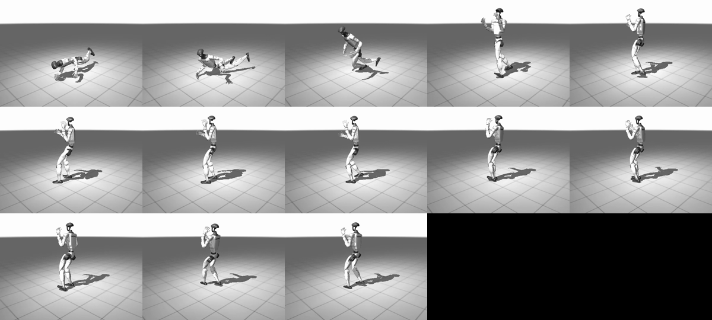

# Getting up after a knockdown (2026-11-12)

Before this, after a knockdown the referee reset both robots standing
(`spar_match --knockdowns N`). A boxer that can get up by itself removes that
reset.

The first two attempts failed. The third and fourth used an upward assist
that was lowered to zero in phases, and they worked. The policy
`checkpoints/getup` stands a fallen G1 up unaided in about 1 s:

- 99–100 % of lying and falling starts, in the GPU stage;
- 24 of 24 knocked-flat robots in native MuJoCo.

`spar_match --getup checkpoints/getup` uses it for a referee's count in
place of the restart ([in bouts](#in-bouts-the-referees-count)).

## The `getup` stage

`UnassistedG1("getup")` (`boxer/curriculum_env.py`) is a GPU (MJX/Warp)
curriculum stage with the usual 29-joint G1 action and observation contract:

- **Floor contacts.** The upstream model lets only the legs and hands touch
  the floor, so a fallen robot would sink through it. The stage adds massless
  colliders (density 0; masses unchanged, checked) for the pelvis, torso,
  shoulders, head, upper arms and forearms (`FLOOR_BODY_GEOMS`). They, the
  thighs, shins and hands touch only the floor.
- **Starts.** 50 % lying (tilted 1.3–1.85 rad about a random horizontal axis:
  back, front or side), 30 % part-way through a fall (0.4–1.1 rad), 20 %
  standing. The joints are near the guard pose, and the robot drops onto the
  floor.
- **No fall termination**, no shoves and no footwork commands. Episodes last
  10 s.
- **Reward** (`getup_reward`, per step × dt):
  - pelvis height, from 0.15 m (0) to 0.75 m (1);
  - from attempt 2, head height (0.12 m to 1.2 m);
  - torso uprightness;
  - a standing bonus with a pull towards the guard pose;
  - a small joint-velocity cost.

`python -m boxer.getup_eval CHECKPOINT` runs 128 starts for 10 s and reports,
per start kind, the share that is ever up (pelvis ≥ 0.72 m, torso within about
25° of upright) and up at the end, with peak and final heights.

## Results

Lying and falling starts are 98 of the 128:

| Policy | Training | Lying or falling: ever up | Lying: peak / final pelvis height | Lying: peak uprightness | Standing starts up at the end |
| --- | --- | --- | --- | --- | --- |
| spar motor (`checkpoints/spar`, never trained to get up) | — | 0 / 98 | 0.30 / 0.11 m | 0.35 | 70 % |
| attempt 1: from the spar motor; pelvis height, upright, standing | 150M steps | 0 / 98 | 0.30 / 0.18 m | 0.37 | 73 % |
| attempt 2: from scratch; head height added | 200M steps | 0 / 98 | 0.30 / 0.10 m | 0.98 | 0 % |

- **Attempt 1** inherited the spar motor's narrow action distribution (some
  scales near 0.001) and barely moved on the floor. The pelvis height
  term pays nothing until the pelvis leaves the floor, which needs most of
  getting up already done.
- **Attempt 2** explored from scratch and found a local optimum. It sits
  with the torso upright and the pelvis on the floor, which earns the
  uprightness and about half the head-height reward with no risk. Even
  robots that start standing sit down.

## Attempts 3 and 4: an assist that fades to zero (worked)

`--getup-assist A` pushes the torso up with a force of A × body weight on
every step, like a harness (`UnassistedG1.step`, stage `getup` only;
`getup_eval --assist A` evaluates with it). Training lowers A in phases, each
continuing from the last. Both attempts drop the head-height term
(`--getup-head-weight 0`), since that is what paid for sitting in attempt 2.

- **Attempt 3** started from scratch: A = 0.7, 0.45, 0.2, 0, 40M steps each.
  With A = 0.7 and 0.45 every lying robot was up within a second while
  assisted. At A = 0.2 none got up from lying even with the assist: the step
  down was too big, and the policy never recovered (0 % alone at A = 0).
- **Attempt 4** continued from attempt 3's A = 0.45 phase in smaller steps:
  0.38, 0.32, 0.26, 0.2, 0.14, 0.08, 0, 30M steps each.

128 starts of 10 s per phase, with the phase's assist and without:

| Phase (A) | Assisted: lying / falling up at end | Alone: lying up at end | Alone: falling up at end | Alone: seconds to up (lying) |
| --- | --- | --- | --- | --- |
| 0.38 | 100 % / 100 % | 0 % | 0 % | — |
| 0.32 | 100 % / 100 % | 0 % | 0 % | — |
| 0.26 | 100 % / 100 % | 0 % | 10 % | — |
| 0.2 | 100 % / 100 % | 14 % | 28 % | 2.1 |
| 0.14 | 100 % / 100 % | 91 % | 97 % | 2.3 |
| 0.08 | 100 % / 100 % | 100 % | 100 % | 1.1 |
| **0 (`checkpoints/getup`)** | — | **99 %** | **100 %** | **0.86** |

The skill crosses over to unassisted between A = 0.2 and 0.08. The final
policy also keeps the standing starts up (100 %). Over 30 s with another seed
(256 starts) it is the same: 99 % of lying and 100 % of falling starts are up
at the end, and up 97 % and 96 % of the time.

It pushes off the floor with both arms, swings the legs under, and rises in
one quick motion. It then holds the guard stance.



**Native MuJoCo.** `PairedFoundation(..., floor_body=True)` adds the same
massless floor colliders to both robots in the two-robot ring
(`build_pair(floor_body=True)`; masses unchanged, checked by a test). In 24
native trials a robot is laid on the floor (random side, as in the stage)
next to a standing opponent (`runs/getup_native_probe.py`). Every one got up,
in 0.76–1.28 s, and 23 of 24 were still up after 5 s. MJX-to-native transfer
needed nothing else.

Total training: 80M steps of attempt 3 (A = 0.7, 0.45) and 210M of attempt
4, about 31k steps/s on the RTX 3060 (about 2.6 h).

```bash
bash runs/getup3.sh    # A = 0.7 0.45 0.2 0, 40M each (only 0.7 and 0.45 used)
bash runs/getup4.sh    # from getup3-a0.45: A = 0.38 ... 0, 30M each
python -m boxer.getup_eval checkpoints/getup --seconds 30 --worlds 256 --seed 3
python -m boxer.getup_eval checkpoints/getup --worlds 32 --seconds 4 --video runs/getup_video.mp4
```

Staged rewards (sit, then kneel, then stand) were not needed and were not
built.

## In bouts: the referee's count

`spar_match --getup checkpoints/getup` turns a knockdown into a count, not a
restart:

- The fallen boxer's joints come from the get-up policy.
- The other boxer waits in guard on its leg motor.
- When the fallen boxer has stood for 0.5 s (`COUNT_STEADY`) and the
  mandatory count is over (`--mandatory-count`, 8 s by default, as in boxing),
  both box on from where they are.
- Still down after 10 s (`--count-seconds`) is a knockout (`method: "ko"`).
- A third knockdown is still a TKO.

Each result lists the `counts`: time, who fell, and seconds down.

32 bouts of 120 s (seeds 0–15, corners swapped, ring, 3 knockdowns):

| Matchup | Referee restart (default) | Count, 0.5 s standing, no mandatory count | Count with the mandatory 8 s | Count, then 2 m apart (`--count-separate 2`) |
| --- | --- | --- | --- | --- |
| whole body vs champion stack | 32–0, knockdowns 8 : 3 | 26–6, 16 : 4, 2 KOs | 26–6, 15 : 2, 3 KOs | 29–3, 10 : 2, 3 KOs |
| striker vs striker-v1 (`spar-native` legs) | 32–0, 15 : 5 | 24–8, 34 : 9 | 25–7, 32 : 11, 2 KOs | 31–1, 20 : 4, 0 KOs |

Seconds down per count: 2.4 and 2.6 without the mandatory count (the rise
itself, plus 0.5 s standing), 8.0 with it.

Getting up works in bouts: 38 of the 49 counts with the mandatory count end
with the boxer back up. The others end the bout: 5 knockouts, and a third
knockdown or the final bell during the count. But the count makes the bouts rougher than the
restart, for three reasons:

- **A fall soon after the restart of boxing.** 15 of the 49 counts follow
  within 3 s of the end of the previous one, and 12 of them knock down the
  same boxer again. Waiting the full 8 s standing in guard did not change
  that (2.4 s → 8 s down; about the same number of falls). So it is not the
  get-up policy being unsteady. A boxer resumes where it got up, often near
  the ropes or the opponent, in a stance its boxing policy never started
  from. The restart rule puts both back 2 m apart in a fresh stance.
- **Knockouts.** 5 boxers in 64 bouts stayed down for 10 s. Their counts did
  not end in a rise: on the ropes or tangled with the waiting boxer, the
  policy did not find the floor it trained on.
- **More scoring for the boxer left standing.** The whole body's win rate
  against the champion drops from 32–0 to 26–6 because it falls more.

So the count stays an option (`--getup`), and the restart remains the
default rule for evaluations.

### Neutral spots after the count (2026-11-13)

`--count-separate 2` does what a referee does before waving the boxers on:
once the count is over, both are moved, as they stand, 2 m apart about the
ring centre on the line between them, each turned to face the other
(`PairedFoundation.separate`). Joint angles and velocities are kept, so it is
not the restart's fresh stance.

It removes about a third of the knockdowns (whole body 15 → 10, striker brawl
32 + 11 → 20 + 4), halves the falls within 3 s of resuming (5 → 3 and 9 → 4),
and brings the win rates back to 29–3 and 31–1. The 3 knockouts against the
champion remain: those boxers never got up, which separation cannot help.
Restarts still fall less (8 : 3 and 15 : 5), so they stay the default for
evaluations; the count with separation is the rule to use for watching bouts
with knockdowns. What is left: train the boxing policies with starts taken
from the end of a get-up, and the get-up policy with the opponent and ropes
close by.

```bash
bash runs/getup8_bouts.sh     # spar_match ... --knockdowns 3 --getup checkpoints/getup (mandatory count 8 s)
bash runs/getupsep_bouts.sh   # the same with --count-separate 2
```

Commands (attempt 2):

```bash
python -m boxer.curriculum_train --stage getup --output runs/getup2 --steps 200000000 --worlds 1024 --checkpoints 30 --seed 51
python -m boxer.getup_eval runs/getup2/checkpoint --output runs/getup2_eval.json
```
